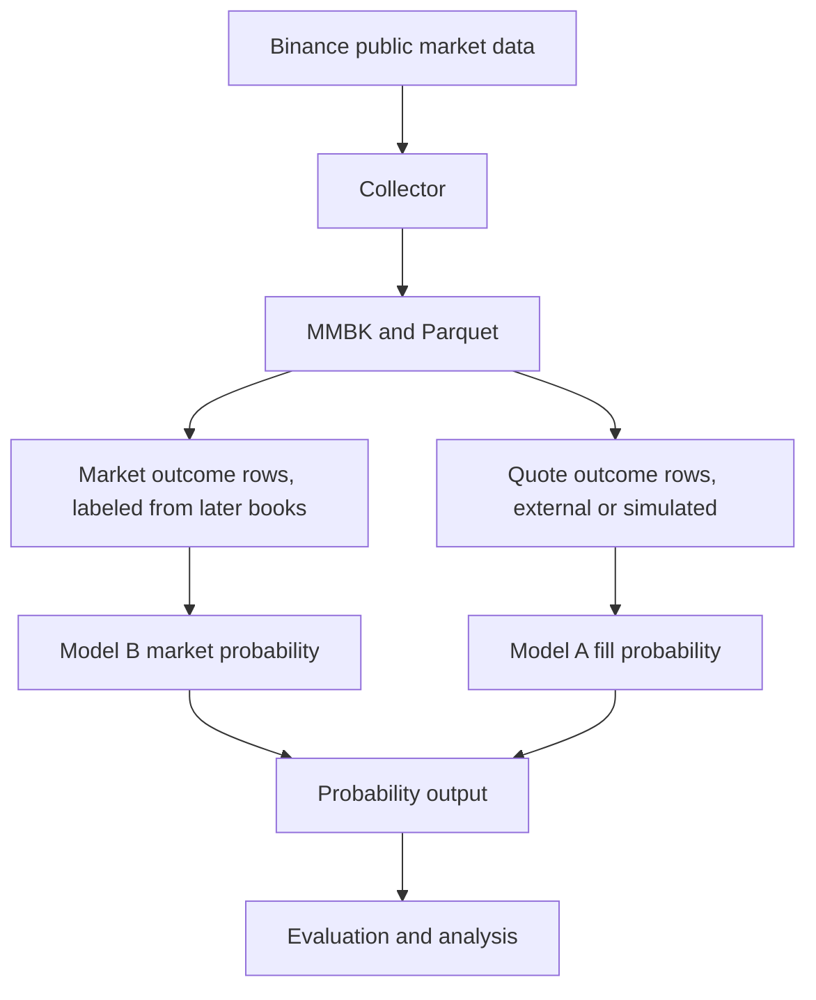
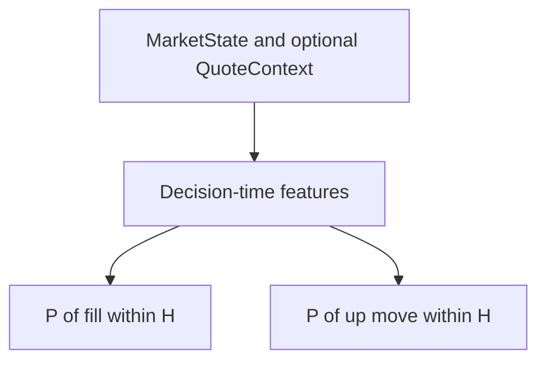
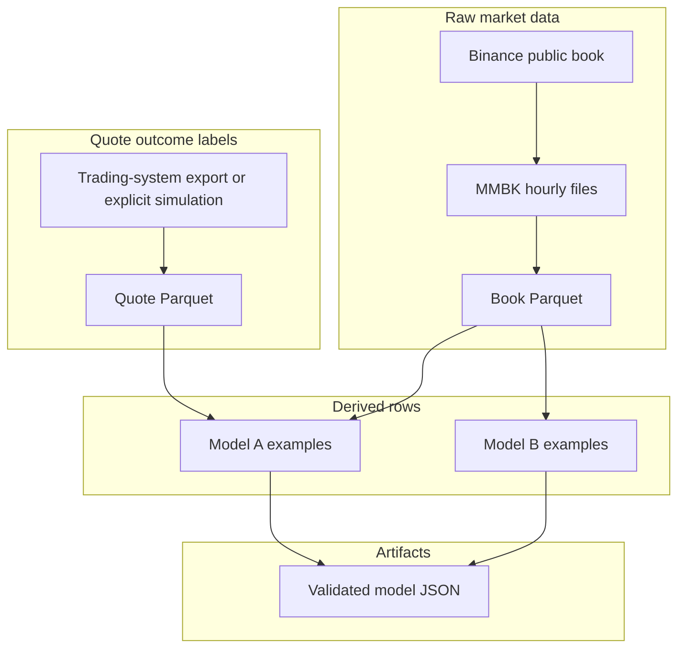
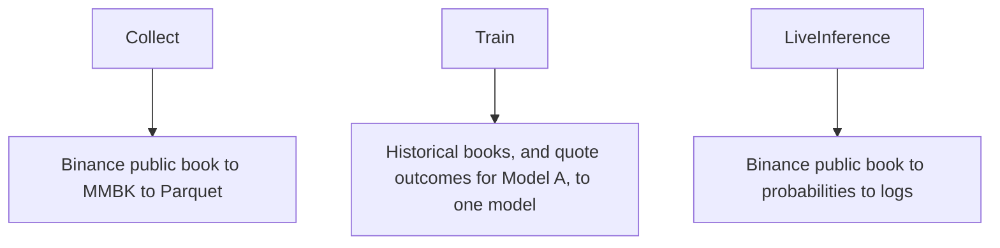
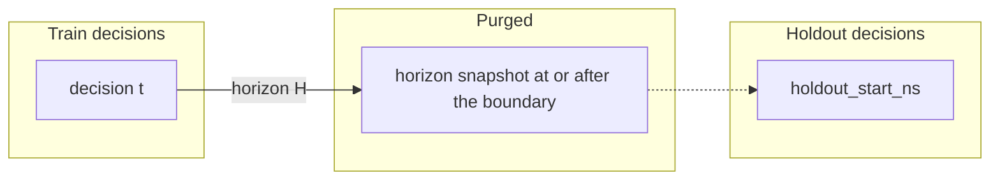

# mm-model

mm-model is an experimental market-microstructure machine-learning research system.

It collects public exchange market data, builds historical datasets, trains and validates predictive models, and exposes probability estimates.

It does not generate trading signals, choose quotes, manage risk, or execute orders. The only exchange connectivity is public market-data ingestion. A model that passes validation is a research artifact. That result is not a trading edge and not a proof of profitability.

The checked-in default, `configs/default.json`, collects BTCUSDT for 30 seconds and then exits. Other workflows are other JSON files, not edits to the binary.

## Architecture

```text
domain  <-  model  <-  data  <-  storage
                              ^
                           runtime  <-  bin
```

`domain` has prices, books, and quote context. `model` estimates probabilities and does not read the network. `data` builds examples. `storage` owns MMBK, the manifest, and Parquet. `runtime` collects, converts, trains, and runs live inference. `bin` only wires those pieces together.



There is no action after the probability.

## What the two models estimate

### Model A — quote-conditioned fill probability

```text
P(fill within H | market state at decision time, quote context)
```

`QuoteContext` is a price and a quantity. It describes the quote whose outcome is being estimated. It is not an order.

For a decision at `t`, the deadline is `t + H`.

- `fill_ns <= t + H` is a positive label. A fill exactly at the deadline is positive. The label is resolved at `fill_ns`.
- No fill through `t + H` is a negative label. That includes a fill that happens later, and an unfilled quote observed until the deadline or beyond. The label is resolved at `t + H`, not at a later fill time.
- An unfilled observation that ends before `t + H` is censored. It is excluded. It is not a negative.

Model A does not use future fair value or P&L to construct its fill label. It needs the decision-time book, the quote context, and the quote lifecycle. A book at `t + H` is not required.

Labels come from outside the public book:

- an export of quotes that were actually submitted, with a fill time or an observed-until time, recorded as `LabelSource::ObservedQuote`;
- an explicitly simulated lifecycle, recorded as `LabelSource::SimulatedQuote`.

Public Binance books do not create fill labels. For the default symbol the quote file is:

```text
<data-root>/quotes/binance/BTCUSDT.parquet
```

Quote Parquet schema version is 2. A filled row stores `fill_ns`, `execution_price`, and `fees`. An unfilled row stores `observed_until_ns` and does not store those fill fields. Schema version 1 is rejected because it has no lifecycle timestamps. `Collect` does not write this file.

### Model B — market-outcome probability

```text
P(reference price rises by at least threshold_bps within H | market state at t)
```

```text
return_bps = (FV_(t+H) - FV_t) / FV_t * 10_000
label      = return_bps >= threshold_bps
```

An exact tie with the threshold is a positive label. The reference price is microprice or midpoint, the same method at `t` and at `t + H`. Model B reads book history only. Collecting public data is enough to train it.

The definition is `MarketOutcomeDefinition::UpMove { horizon_ns, threshold_bps }`. Other outcomes are not implemented.



Quote probes are hypothetical contexts. A live log can show several of them. None is a winner, a recommendation, or a selected quote.

```text
distance 0.5 bp, quantity 0.001, fill probability 0.72
distance 1.0 bp, quantity 0.001, fill probability 0.54
```

## Data lineage



- MMBK is the raw source of truth for the book. A torn tail is ignored on read and truncated before the next append.
- Book Parquet is a rebuildable copy of a closed UTC hour. Paths come from the partition id, not from the manifest.
- Quote Parquet schema version 2 is supervised fill history, including fill time or observed-until time. It is not produced from the public book. Schema version 1 is rejected.
- A model artifact is derived output. It can be deleted and rebuilt.

## Storage

The data root is the `data_root` field in the JSON config. `MM_DATA_ROOT`, when set, replaces that field before relative paths are joined. Absolute paths stay absolute.

```text
<data-root>/raw/binance/BTCUSDT/<YYYY-MM-DD>/<HH>.mmbk
<data-root>/books/binance/BTCUSDT/<YYYY-MM-DD>/<HH>.parquet
<data-root>/manifest.json
<data-root>/quotes/binance/BTCUSDT.parquet
<data-root>/models/current.json
```

MMBK records are fixed width, magic `MMBK`, version 1. The collector appends to the open hour. Shutdown flushes that hour and leaves it open. Startup closes open partitions whose hour has ended, then wakes conversion. The manifest is version 2 and does not store filesystem paths. Conversion publishes one closed hour at a time. The worker is woken by a one-slot signal. Collection does not wait for training, because training is a separate run.

## Runtime modes



There is no command-line parser. The mode is the `task.mode` field of the JSON file named by `MM_CONFIG`. When that variable is unset, the binary loads `configs/default.json`.

| Mode | Opens the Binance websocket | Fits a model | Writes quote labels |
| --- | --- | --- | --- |
| `Collect` | yes | no | no |
| `Train` | no | yes, from files already on disk | no; Model A reads quote Parquet |
| `LiveInference` | yes | no | no |

`Train` does not open the websocket. Model A without a quote file stops with a quote-history error. Model B does not read that file. `Collect` does not fit a model. `LiveInference` does not store labels. There is no combined collect-and-train mode and no automatic retraining.

## How a model is fit

Both families use the same logistic regression:

```text
z = bias + w · x
P = sigmoid(z)
```

Training is full-batch gradient descent, learning rate 0.2, 200 epochs, on the post-purge training slice. Sample order is the update order. A non-finite probability is an error. It is not replaced with 0.5.

Rows are sorted by decision time. With `n` rows and holdout percent `h`, the training-candidate count is `n * (100 - h) / 100` using integer division. The default `h` is 20. The split is never shuffled.

```text
holdout_start_ns = decision time of the first holdout row
```

A training candidate is kept only when its decision is before the holdout and its label-resolution time is also before the holdout. For Model A that time is `label_resolved_ns`: the fill time when the fill is inside `H`, otherwise `t + H`. An early fill can stay in training even when `t + H` falls inside the holdout. For Model B the resolution time is the future book snapshot. A candidate whose label reaches the holdout is removed from fitting. It is not moved into the holdout. If purging leaves too little evidence, the result is `TrainOutcome::InsufficientData`.

The quote-fill build also reports how many input rows were usable positives, usable negatives, or censored because observation ended before `t + H`.



Evidence is counted after the purge. The defaults are 8 training rows, 3 positives, and 3 negatives, plus 4 holdout rows, 2 positives, and 2 negatives.

The baseline is the training positive rate, as a constant probability. On the untouched holdout the learned model is validated only when:

```text
holdout log loss < constant-baseline log loss
```

The comparison is strict. A tie is not validated. The same rule is used by the trainer and by `ModelArtifact::validated`.

The artifact also stores the holdout Brier score and ten calibration bins, `0.0–0.1` through `0.9–1.0`. Each populated bin records the count, the mean predicted probability, and the observed positive frequency. Empty bins record a count of zero. Calibration is reported. It is not a second acceptance gate.

Passing this rule means the probability model beat a constant on the holdout of submitted quotes, or of public-book up moves. It does not mean a quote should be sent.

## Feature schemas

Quote features, `FEATURE_SCHEMA_VERSION` 2, five coordinates. The three price distances are multiplied by 10_000, so one basis point is about 1.

| Index | Name | Definition |
| --- | --- | --- |
| 0 | `quote_distance_from_fair` | `(fair - quote_price) / fair * 10_000` |
| 1 | `exchange_spread` | `(ask - bid) / fair * 10_000` |
| 2 | `quote_distance_from_best_bid` | `(quote_price - bid) / fair * 10_000` |
| 3 | `top_quantity_imbalance` | `(bid_qty - ask_qty) / (bid_qty + ask_qty)` |
| 4 | `relative_candidate_quantity` | `quote_qty / (bid_qty + ask_qty)` |

Under midpoint, feature 2 is an exact linear combination of features 0 and 1. Under microprice, `fair - bid = spread * (1 + imbalance) / 2`. That product is not a linear function of spread and imbalance separately, so a linear model cannot rebuild feature 2 from features 1 and 3. The weight is not treated as inherently unidentifiable under microprice.

Market features, schema version 1, three coordinates, all from the current touch:

| Index | Name | Definition |
| --- | --- | --- |
| 0 | `exchange_spread_bps` | `(ask - bid) / fair * 10_000` |
| 1 | `top_quantity_imbalance` | `(bid_qty - ask_qty) / (bid_qty + ask_qty)` |
| 2 | `microprice_minus_midpoint_bps` | `(microprice - midpoint) / fair * 10_000` |

The future reference price is the label, not a feature.

## Fair value

`FairValueMethod::Microprice` is the checked-in default:

```text
(ask * bid_qty + bid * ask_qty) / (bid_qty + ask_qty)
```

`FairValueMethod::Midpoint` is `(bid + ask) / 2`.

Both reject an empty book, a non-finite or non-positive price or quantity, and a locked or crossed book. There is no silent fallback. Microprice is a function of the Binance book, not an independent true value.

## Artifacts

JSON artifact version is 5. A file records the model family, target horizon, threshold for an up move, feature schema, fair-value method, label source, training window, dataset id, weights, and the validation report. Older artifacts are rejected. A quote-fill artifact's `training_horizon_ns` is the `H` used to decide whether a fill was inside the horizon. Live probabilities for that artifact are probabilities of a fill within that horizon.

Live inference reads those files. It does not embed a second copy of the target in the config. The artifact's family, horizon, and threshold are what get checked against the run's fair-value method.

## Live inference

Each public book is turned into a `MarketState`. If a market model is loaded, the process logs `P(up move)`. If a quote model is loaded, each probe is logged with its own fill probability, in grid order. After startup, scoring writes into caller-owned buffers. Storage, training, and logging may allocate.

## Project structure

```text
src/
├── domain/      prices, books, quote context, historical observation labels
├── model/       fair value, features, logistic regression, calibration, artifact
├── data/        Binance client, quote dataset, market-outcome dataset
├── storage/     MMBK, manifest, book Parquet, quote Parquet
├── runtime/     collector, converter, trainer, orchestrator, live inference
└── bin/         mm_model.rs composition root
configs/         checked-in experiment files
```

## How to run

The binary loads one JSON file. `MM_CONFIG` is that path. Without it, the path is `configs/default.json`, which collects BTCUSDT for 30 seconds into `./data` and then exits. Run it from the repository root so that relative path exists.

```bash
just build
just run
just run-config configs/collect-btcusdt-2h.json
```

`just run` and `just run-config` use the features `live`, `observe`, `artifact`, and `parquet-storage`.

### Collect

```bash
just run-config configs/collect-btcusdt-2h.json
```

That records Binance spot BTCUSDT, top 10, 100 ms, microprice, for two hours. Partitions are UTC hours, and the hour that is still open is not published until it closes. Two wall-clock hours can therefore produce fewer than two complete book partitions, depending on when the process starts.

```bash
just run-config configs/collect-btcusdt-continuous.json
```

`run_for_seconds: null` runs until SIGINT or SIGTERM. Zero is not a stand-in for that. Zero is rejected.

### Train Model B

```bash
just run-config configs/train-market-up-1bp-1s.json
```

This fits `P(reference price rises by at least 1 bp within 1 s)` from book history only. `configs/train-market-up-2bp-5s.json` is the same family with a 2 bp threshold and a 5 second horizon. No quote file is read.

### Train Model A

```bash
just run-config configs/train-quote-fill-1s.json
```

This fits `P(fill within 1 s | market state, quote context)`. It reads `./data/quotes/binance/BTCUSDT.parquet`. Each row needs a decision time, quote price, and quantity, plus either a fill time with execution price and fees, or an observed-until time for a quote that had not filled. An observation that ends before the one-second deadline is censored and left out of the fit. The file is an export from a system that submitted the quotes, or an explicitly simulated lifecycle. `Collect` does not create it.

### Live inference

```bash
just run-config configs/live-inference-market.json
just run-config configs/live-inference-quote-fill.json
just run-config configs/live-inference-both.json
```

Each entry in `models` is an artifact path. The file's own family decides whether the process logs an up-move probability or fill probabilities. Quote probes are hypothetical contexts. A distance of `1.0` is one basis point below the current reference price. The log lists every probe. It does not rank them.

`live-inference-both.json` scores one market artifact and one quote-fill artifact on the same public book.

## Config reference

Checked-in samples in `configs/` are the practical schema. The root fields are:

| Field | Meaning |
| --- | --- |
| `version` | Must be `1` |
| `data_root` | Base directory for relative data and artifact paths |
| `market.exchange` | `binance_spot` |
| `market.symbol` | ASCII letters and digits, for example `BTCUSDT` |
| `market.depth` | `5`, `10`, or `20` |
| `market.update_ms` | `100` or `1000` |
| `market.fair_value` | `microprice` or `midpoint` |
| `task.mode` | `collect`, `train`, or `live_inference` |

Collect adds `run_for_seconds` (`null` until a signal) and `flush_every_records`. Train adds `target` (`quote_fill` or `market_up_move`), `history`, `artifact_path`, and `validation`. Quote fill also requires `quote_history_path`. Market up-move adds `threshold_bps` and must not set a quote path. Live inference adds `report_every_seconds` and a `models` array. A quote-fill artifact in that array carries `quote_probes` of `distance_bps` and `quantity`. A market artifact does not.

`MM_DATA_ROOT` overrides `data_root`. It does not override anything else. `MM_CONFIG` is the only other environment variable, and it selects the file rather than a data path.

## Data directory

`./data` is gitignored. Docker Compose mounts it at `/data`, sets `MM_DATA_ROOT=/data`, and sets `MM_CONFIG=/app/configs/default.json`. The image includes the sample configs and no historical books, quote history, or model artifacts. It runs as uid 10001, so a collect or train run needs that directory writable by uid 10001.

```bash
just docker-build
just docker-run
just docker-up
just docker-down
```

`docker-up` builds and runs Compose. The default config exits after 30 seconds. `docker-down` removes the container and leaves `./data` in place. Compose drops all capabilities, sets a read-only root filesystem, and publishes no ports.

A different experiment can be mounted without rebuilding:

```bash
docker run --rm \
  -e MM_CONFIG=/config/run.json \
  -e MM_DATA_ROOT=/data \
  -v ./configs/collect-btcusdt-2h.json:/config/run.json:ro \
  -v ./data:/data \
  mm-model
```

The sample inside the image is also usable directly:

```bash
docker run --rm \
  -e MM_CONFIG=/app/configs/collect-btcusdt-2h.json \
  -e MM_DATA_ROOT=/data \
  -v ./data:/data \
  mm-model
```

## Development commands

```bash
just fmt
just clippy
just tests
just check
```

`just check` is format, clippy with `-D warnings` on all targets and features, then `cargo test --all-features`. Tests do not open a live exchange connection. One ignored test can open the public websocket if you run ignored tests yourself.

## Known limitations

- Buy-side quote context only. There is no sell model.
- Binance spot only.
- The book is a partial top-N book, default top 10.
- Fair value is microprice or midpoint only.
- Model B has one target: an upward move of at least a threshold.
- Probe offsets are a fixed grid of hypothetical quote contexts.
- No queue-position model.
- No partial fills.
- No inventory model.
- No live trading and no order entry.
- No counterfactual fill labels for quotes that were not submitted.
- Logistic regression is full-batch.
- The training window is materialized in memory.
- No demonstrated predictive edge beyond the holdout comparison with a constant rate.

## Security and dependencies

`cargo audit` reports:

- `RUSTSEC-2026-0435` in `thrift` 0.17.0, reached through the Parquet stack. This pass does not upgrade Arrow or Parquet to clear it.
- `RUSTSEC-2024-0436`, the unmaintained `paste` crate, as a warning.

Socket read and write timeouts are set before the websocket is used. A failure to set them aborts the connection. Rustls is installed before connect. Paths for raw and Parquet files are derived from the data root and the partition id.
