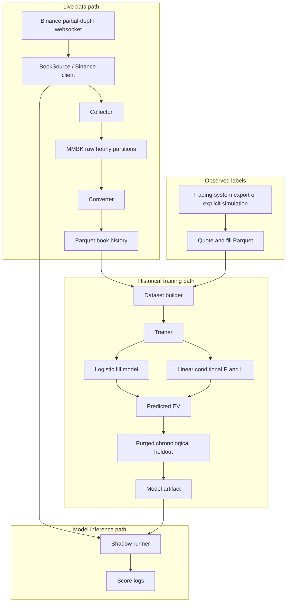
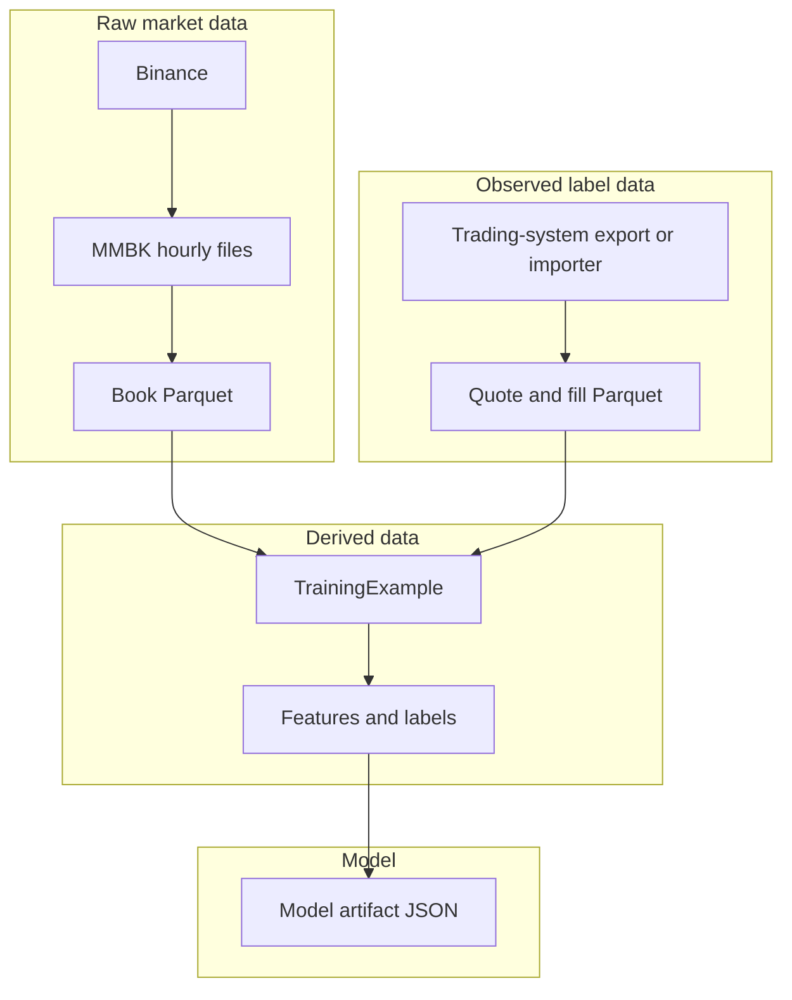
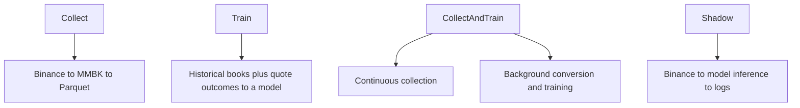
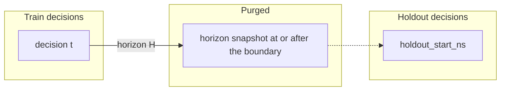

# mm-model

Experimental buy-side quote study bench. It records a Binance spot book, joins that book to an external quote/fill history, fits two small models, and can score a fixed candidate grid in shadow mode.

This repository is a curriculum reference for that pipeline. It does not send orders. A model that passes validation is cleared for shadow logging only. That result is not a trading edge, not a proof of profitability, and not a claim that the selected quote is the best quote that could have been sent.

The checked-in default process runs in shadow mode for 30 seconds and prints that its demo model is not trading-valid.

## Architecture

Dependencies point one way:

```text
domain  <-  model  <-  data  <-  storage
                              ^
                           runtime  <-  bin
```

`domain` has no dependency on the other layers. `model` does not read files or the network. `data` turns books and quote events into examples. `storage` owns MMBK, the manifest, and Parquet. `runtime` runs collection, conversion, training, and shadow scoring. `bin` only wires those pieces together.



## What problem the model solves

At a decision time `t`, the book supplies a reference price `FV_t`. A buy quote is a price and a quantity on a fixed offset grid. The model estimates:

```text
P(fill | X)
E[P&L | fill, X]
EV = P(fill | X) * E[P&L | fill, X]
```

`X` uses only the decision-time book and the candidate quote. The label is what happened to a quote that was actually submitted:

```text
filled:   (FV_(t+H) - execution_price) * quantity - fees
unfilled: 0
```

The same fair-value method is used at `t` and at `t+H`. Microprice is the default. It is a function of the Binance book, not an independent true value.

`NoQuote` has EV 0. Among candidates with positive EV, the smaller candidate id wins a tie.

## Data flow



- MMBK is the raw source of truth for the book. A torn tail is ignored on read and truncated before the next append.
- Book Parquet is a rebuildable analytical copy of a closed hour. Paths are derived from the partition id, not stored in the manifest.
- Quote Parquet is the supervised label history. Public market data does not create it.
- The model artifact is a derived output. It can be deleted and rebuilt from books plus quote history.

## Storage model

The data root is `./data`, or `MM_DATA_ROOT` when that variable is set.

```text
<data-root>/raw/binance/BTCUSDT/<YYYY-MM-DD>/<HH>.mmbk
<data-root>/books/binance/BTCUSDT/<YYYY-MM-DD>/<HH>.parquet
<data-root>/manifest.json
<data-root>/quotes/binance/BTCUSDT.parquet
<data-root>/models/current.json
```

MMBK records are fixed width, magic `MMBK`, version 1. Hours are UTC. The collector appends to the open hour and flushes on an interval. Shutdown flushes the open hour and leaves it open. Startup closes open partitions whose hour has already ended, then asks the conversion worker to scan the manifest.

The manifest is version 2. It records partition identity and state. It does not store filesystem paths. Conversion publishes one closed hour at a time, oldest first. The worker is woken by a one-slot signal. If the worker is already scheduled, collection continues and the worker scans the manifest when it runs.

Quote Parquet is schema version 1. A filled row stores an execution price and fees. An unfilled row stores both as null. A missing quote file means there are zero quotes.

## Runtime modes



There is no command-line parser. The mode is the `mode` field inside `configuration()` in `src/bin/mm_model.rs`.

| Mode | Opens the Binance websocket | Fits a model | Stores training labels |
| --- | --- | --- | --- |
| `Collect` | yes | no | no |
| `Train` | no | yes, from files already on disk | reads quote Parquet; does not write it |
| `CollectAndTrain` | yes | yes, on closed partitions, from the quote file | reads quote Parquet; does not write it |
| `Shadow` | yes | no | no |

`Train` does not open the websocket. If the quote file is missing or empty, training stops with a quote-history error or `SkippedNoLabels` and does not scan the book source for labels.

`Collect` writes books. It does not fit a model, and it does not invent quote outcomes.

`CollectAndTrain` keeps collecting when the quote file is absent. That cycle is `SkippedNoLabels`. It is not online learning. Each training cycle rebuilds examples from the current book window and the current quote file.

`Shadow` scores the live book and logs predictions. Those logs are not realized fills or realized P&L. With `demo_model: true` the process prints `DEMO MODEL — predictions are not trading-valid` and does not load an artifact.

## Model mechanics

Two reference models are fit by full-batch gradient descent, learning rate 0.2, 200 epochs, on the post-purge training slice:

- logistic regression for `P(fill | X)`, with a constant fill-rate baseline (logit of the training fill rate, zero weights);
- linear regression for `E[P&L | fill, X]`, with a constant baseline equal to the training mean P&L of filled quotes, zero weights.

Combined EV is the product of the two predictions. The constant EV baseline is:

```text
training fill rate * training mean P&L of filled quotes
```

Both factors come from the post-purge training slice. Holdout outcomes are not used to set them.

Probabilities that are NaN stay NaN. They are not replaced with 0.5.

## Feature schema

`FEATURE_SCHEMA_VERSION` is 2. `FEATURE_COUNT` is 5. The three price distances are multiplied by `PRICE_RATIO_SCALE` (10_000), so one basis point is about 1.

| Index | Name | Definition |
| --- | --- | --- |
| 0 | `quote_distance_from_fair` | `(fair - quote_price) / fair * 10_000` |
| 1 | `exchange_spread` | `(ask - bid) / fair * 10_000` |
| 2 | `quote_distance_from_best_bid` | `(quote_price - bid) / fair * 10_000` |
| 3 | `top_quantity_imbalance` | `(bid_qty - ask_qty) / (bid_qty + ask_qty)` |
| 4 | `relative_candidate_quantity` | `quote_qty / (bid_qty + ask_qty)` |

Under midpoint, feature 2 is an exact linear combination of features 0 and 1. Under microprice, `fair - bid = spread * (1 + imbalance) / 2`. That product is not a linear function of spread and imbalance separately, so a linear model cannot rebuild feature 2 from features 1 and 3. The feature is kept. Its weight is not treated as inherently unidentifiable under microprice.

Extraction reads the decision-time book and the candidate only.

## Fair-value calculation

`FairValueMethod::Microprice` is the checked-in default:

```text
(ask * bid_qty + bid * ask_qty) / (bid_qty + ask_qty)
```

`FairValueMethod::Midpoint` is `(bid + ask) / 2`.

Both reject an empty book, a non-finite or non-positive price or quantity, and a locked or crossed book (`bid >= ask`). There is no silent fallback to the other method. The method used at the decision must be the method used at the horizon.

## Training dataset construction

For each quote event the builder takes:

- the latest valid book with `timestamp <= decision_ns`;
- the first valid book with `timestamp >= decision_ns + horizon_ns`.

Default maximum staleness and horizon slippage are 5 seconds (`5_000_000_000` ns). A row that fails those checks is dropped. Mixed label provenance in one fit is rejected. A buy fill whose execution price is above the quote price is rejected. Simulated labels are not written into a shadow artifact.

`TrainingExample` stores `decision_ns`, `decision_snapshot_ns`, `requested_horizon_ns`, and `horizon_snapshot_ns`. The split uses `decision_ns` and `horizon_snapshot_ns`, not an estimate of the horizon length.

## Chronological holdout and purge

Rows are sorted by `decision_ns`. With `n` rows and holdout percent `h`, the training-candidate count is `n * (100 - h) / 100` using integer division. The remainder is the holdout. The default `h` is 20. The split is never shuffled.

```text
holdout_start_ns = decision_ns of the first holdout row
```

A training candidate is kept only when both of these hold:

```text
decision_ns < holdout_start_ns
horizon_snapshot_ns < holdout_start_ns
```

A candidate whose horizon snapshot is at or after `holdout_start_ns` is purged. It is not moved into the holdout. The holdout rows stay the rows whose decision time is at or after `holdout_start_ns`.



```text
time ------------------------------------------------------>

TRAIN DECISIONS                 PURGED              HOLDOUT
xxxxxxxxxxxxxxxx                -----            xxxxxxxxxxxxx

               decision t
                    |
                    +------ H ------> horizon label
                                      crosses boundary
                                      therefore purge
```

Evidence counts are computed after that purge. The defaults are 8 training examples, 3 fills, and 3 misses, plus 4 holdout examples, 2 fills, and 2 misses. If purging drops the training slice below those counts, the result is `TrainOutcome::InsufficientData`. The purge is not relaxed to make a model fit.

`ValidationReport` records `rows_before_purge`, `purged_training_rows`, `train_examples` (the fitted count, equal to `rows_before_purge - purged_training_rows`), `holdout_examples`, and `holdout_start_ns`.

## Model validation

On the untouched holdout, a shadow artifact is written only when all of these hold:

```text
fill loss          <=  constant training fill-rate loss
conditional P&L    <=  constant training filled-P&L loss
combined EV error  <   constant training EV error
```

The EV comparison is strict. A model that only ties the constant historical EV is not published.

The EV error is the mean absolute error, on quotes that were actually submitted, between predicted EV and the observed attempt outcome (`filled` mark-to-fair P&L, or `0` if unfilled). It asks whether the learned EV estimates that outcome better than the constant training EV.

Passing this rule permits shadow experimentation only. It does not demonstrate trading profitability or counterfactual quote optimality. It does not score quotes that were never submitted.

`ModelArtifact::published_for_shadow` and the trainer both call `losses_accept` for the three comparisons, so a report the trainer rejects cannot be constructed as a shadow artifact.

Artifact files are JSON version 3. Version 2 did not record the purge boundary and used a non-strict EV comparison. `demo_model` does not read an artifact.

## Shadow inference

Shadow builds a `MarketState` from each book, generates the configured buy grid, extracts features into caller-supplied buffers, evaluates the logistic and linear models, and selects a quote or `NoQuote`. After startup, that scoring path does not allocate. Storage, training, and logging may allocate.

The checked-in grid is quantity `0.001` and offsets `0.5, 1, 2, 5` basis points. A periodic stats line is not a fill or a P&L.

## Project structure

```text
src/
├── domain/      prices, quantities, books, instruments, fair-value method
├── model/       fair value, features, logistic fill, linear P&L, EV, artifact
├── data/        Binance client, book source, dataset builder, quote history
├── storage/     MMBK, manifest, book Parquet, quote Parquet
├── runtime/     collector, converter, trainer, orchestrator, shadow, config
└── bin/         mm_model.rs composition root
```

## How to run

Edit `configuration()` in `src/bin/mm_model.rs`. The checked-in default is:

```rust
mode: RunMode::Shadow
```

with `demo_model: true`, `run_for` 30 seconds, symbol `BTCUSDT`, exchange Binance spot, depth 10, update interval 100 ms, and `FairValueMethod::Microprice`.

Changing `mode` to `RunMode::Collect`, `RunMode::Train`, or `RunMode::CollectAndTrain` changes the workflow. There are no command-line subcommands.

```bash
just build
just run
```

`just run` uses the features `live`, `observe`, `artifact`, and `parquet-storage`. Set `MM_DATA_ROOT` to put files somewhere other than `./data`.

### Train needs a quote file

`Train` reads quote/fill history from the configured path. For the default BTCUSDT setup that path is:

```text
<data-root>/quotes/binance/BTCUSDT.parquet
```

That file is not produced from the public book. It has to be an export of actual quote and fill history, or an explicitly simulated dataset written in the quote schema. `Collect` does not create it, so collection alone does not make the supervised model trainable.

The training window in the default config is `0 .. i64::MAX/4`, the horizon is 60 seconds, and training is requested after every newly published partition. Those values are only used when the mode trains.

## Data directory

`./data` is gitignored. Docker Compose mounts it at `/data` and sets `MM_DATA_ROOT=/data`. The image runs as uid 10001, so a collect or train run needs that directory writable by uid 10001. The image does not contain historical books or quote history.

```bash
just docker-build
just docker-run
just docker-up
just docker-down
```

`docker-up` builds and runs Compose. The container exits when `run_for` elapses. `docker-down` removes the container and leaves `./data` in place. Compose drops all capabilities, sets a read-only root filesystem, and publishes no ports.

## Development commands

```bash
just fmt
just clippy
just tests
just check
```

`just check` is format, clippy with `-D warnings` on all targets and features, then `cargo test --all-features`. Tests do not open a live exchange connection. One ignored test can open the public websocket if you run ignored tests yourself.

## Known limitations

- Buy side only.
- Binance spot only.
- Top-of-book depth is a partial book (default top 10).
- Fair value is microprice or midpoint only.
- The candidate set is a fixed offset grid.
- No queue-position model.
- No partial fills.
- No inventory model.
- No live trading and no order entry.
- No counterfactual labels for quotes that were not submitted.
- Regression is full-batch.
- The training window is materialized in memory.
- No demonstrated trading edge.

A published shadow artifact means the learned combined EV was strictly closer to the outcomes of submitted quotes than a constant computed from the purged training slice. It does not mean the strategy is profitable.

## Security and dependencies

`cargo audit` reports:

- `RUSTSEC-2026-0435` in `thrift` 0.17.0, reached through the Parquet stack. This pass does not upgrade Arrow or Parquet to clear it.
- `RUSTSEC-2024-0436`, the unmaintained `paste` crate, as a warning.

Socket read and write timeouts are set before the websocket is used. A failure to set them aborts the connection. Rustls is installed before connect. Paths for raw and Parquet files are derived from the data root and the partition id.
